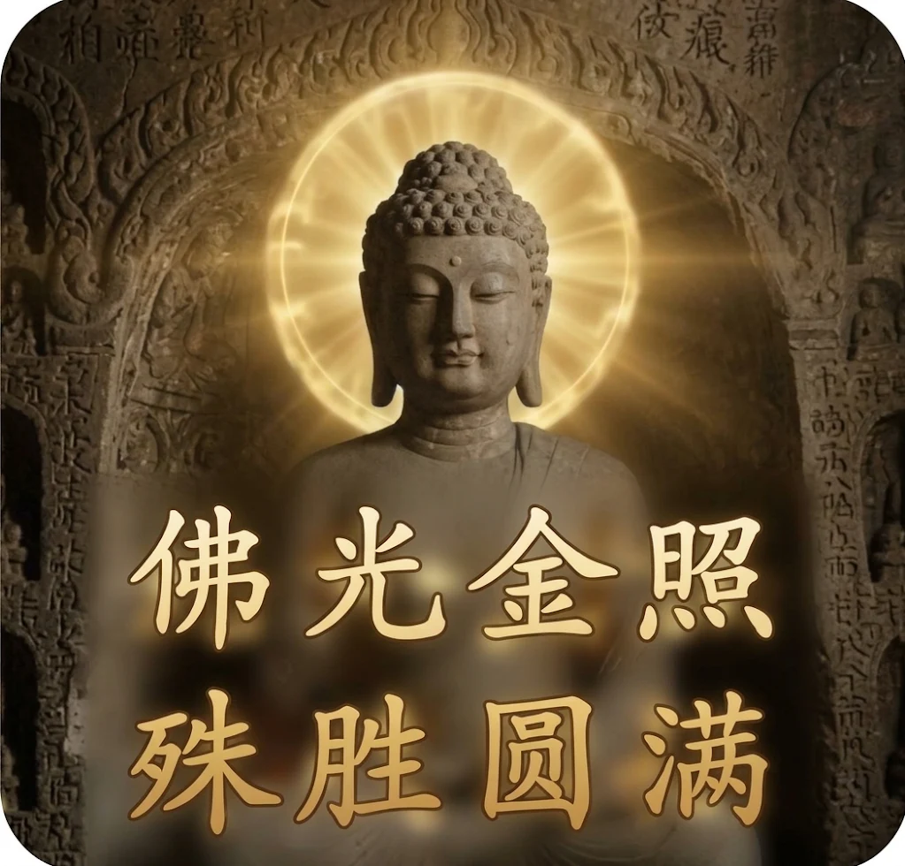
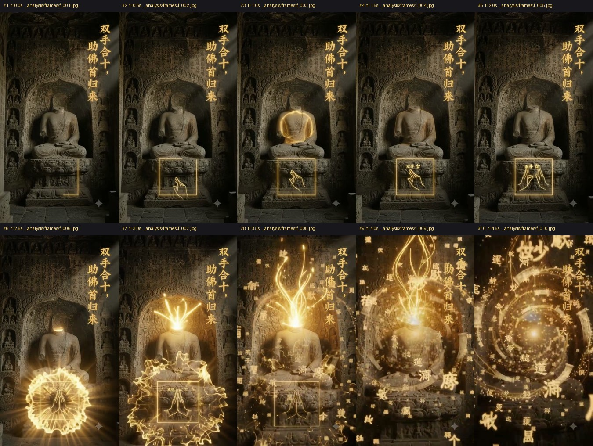
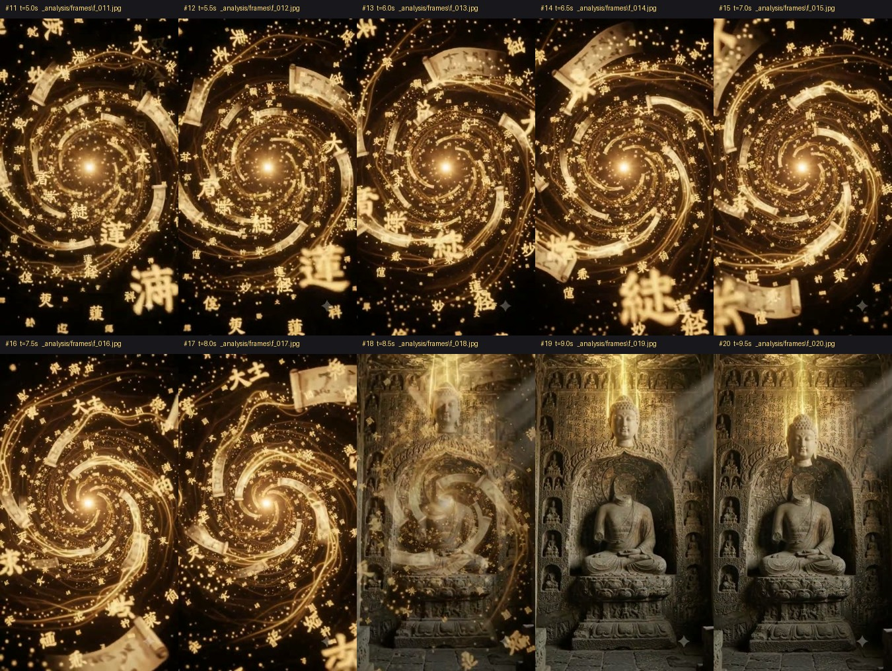
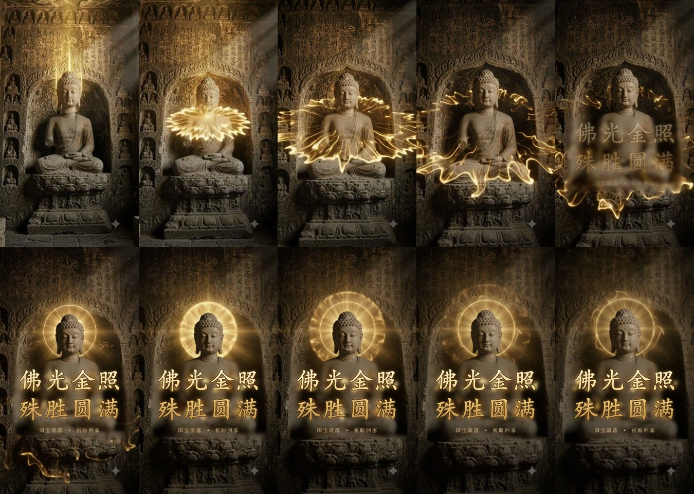

<p align="center">
  
</p>

<h3 align="center">响&nbsp;堂&nbsp;山&nbsp;佛&nbsp;首&nbsp;归&nbsp;来</h3>

<p align="center">
  基于Effect House平台的沉浸式国风特效《响堂山佛首归来》
</p>

  
## 项目简介

该项目为AR互动特效，名为《响堂山佛首归来》，以**唤起文物记忆与祈盼文化回归**为主题。<br/>
当用户做出「双手合十」这一虔诚手势后，唤起流失海外佛首「归乡」的叙事，营造「以身入画、与佛共鸣」的沉浸体验，弘扬善德。
<br/>
<br/>
## 效果演示

| 阶段 | 画面 | 说明 |
|---|---|---|
| 心诚 | | 石窟场景<br/>手形引导<br/>四角星光 |
| 佛光 | | 主片播放 |
| 圆满 | | 佛光金照<br/>殊胜圆满 |
<br/>


## 交互流程

| 状态 | 画面表现 | 图层逻辑 |
|---|---|---|
| **IDLE 待机** | 实时人像（实心抠像）+ 文案/金手/星光/石窟背景 | 13 人像层显示，01 主片隐藏，02/03/05 提示常驻 |
| **PLAYING 播放** | 整屏只展示 20s 特效影片，**无实时人像** | 立即隐藏 13 人像层与 11 背景，01 主片 `opacity=1.0` 从头播放；04/06/10/07/08 按时间轴出现 |
| **END 定格** | 影片最后一帧定格，文案与合十手形重新出现 | 主片停在当前帧，02/03 提示复现，**人像仍隐藏** |
| 回 IDLE | 人像重新出现、可再次拍摄 | 定格 3.5s 后自动 `enterIdle()`，恢复 13 人像层与全部提示 |

<br/>

## 技术架构

### 平台框架

| 维度 | 选型 |
|---|---|
| 创作工具 | 字节跳动 **像塑（Douyin AR）桌面版 9.7.2**（内部称 Effect House / Pixel Effect 工程格式） |
| 脚本运行时 | **APJS（AmazingProJS）** —— 像塑内置 TypeScript/JavaScript 组件框架 |
| 脚本语言 | TypeScript（`.ts`），经像塑 OTSC 编译器转译为引擎可执行的 JS |
| 手势算法 | 像塑官方 **Gesture Detection** 节点（2handGestureDetect） |
| 人像分割 | 像塑官方 **Portrait Segmentation** 内置对象 |
| 视频纹理 | **Mp4TextureProvider**（MP4 解码为可贴图纹理） |

### 工程结构

```
像塑工程/
├── Assets/
│   ├── main.scene                  # 场景：实体/组件定义（YAML 1.1 多文档）
│   ├── main.scene.extra            # 编辑器元数据（guid.a ↔ scene.path 对应）
│   ├── Film_20s.mp4                # 20 秒主片源（H.264，重编码素材，不进包）
│   ├── Film_20s.mp4.folder/
│   │   └── encoded.mp4             # 编辑器转码的 HEVC hvc1 版本（671KB，进包）
│   ├── Film_20s MP4 播放器.mp4Tex  # Mp4Texture 资源（引用 encoded.mp4）
│   ├── 纹理/                       # Gesture_Box.png 等引导/背景贴图
│   ├── 分割材质 (1).omtl           # 人像分割材质
│   ├── 人像抠图纹理 (1).segTex     # Portrait 分割纹理
│   ├── Scripts/
│   │   └── FoShouNamaste.ts        # ★ 交互控制核心脚本（TypeScript）
│   └── temp.folder/                # 删除资源回收站（不进包，定稿可清）
├── Graph/
│   └── graph.json                  # 算法图：声明双手手势检测能力
├── Library/                        # 编辑器缓存（CacheData / 编译产物，不进包）
├── Scripts/
│   └── manifest.json               # 工程自述清单（图层/交互/配置文档）
├── 封面/
│   └── 特效封面_响堂山.svg          # 发布用方形封面（矢量）
├── screenshots/                    # README 配图
└── README.md

```

### 核心脚本

`Assets/Scripts/FoShouNamaste.ts` 是一个 `@component()` 装饰的 `APJS.BasicScriptComponent`，
通过编辑器 MCP 的 `add_script` 创建，序列化为场景中的 `DynamicComponent`（`className` = 脚本资源 resGuid），
挂载在「2D 相机」实体上。主要成员：

| 方法 / 字段 | 职责 |
|---|---|
| `bindLayers()` | 启动重试按名查找 12 个图层实体（`scene.findSceneObject(name)`），失败重试避免首帧未就绪 |
| `detectNamaste()` | 调用 `AlgorithmManager.getResult()` 判定双手合十（Namaste/Beg/Pray 均算） |
| `update(dt)` | 主循环：手势迟滞累加 → 状态机分发 → 时间轴显隐 → 结束判定 |
| `restartFilm()` | 取主片 `texture.getControl()`（Mp4TextureProvider），`loopCount=1` + `stop()` + `play()` 从头播 |
| `filmTime()` / `filmFinished()` | 读取播放器真实进度（微秒→秒）与结束状态 |
| `show()` / `alpha()` | 图层显隐 / 透明度设置（均带同值守卫，避免每帧无效 setter） |
| `enterIdle()` / `startFilm()` / `enterEnd()` | 状态切换与图层编排 |
| `bindAudio()` | 启动后取宿主子物体「BgmPlayer」上的 `AudioComponent`，缓存到 `bgm` 字段 |
| `playBgm()` / `stopBgm()` | 合十触发时 `play()` 背景音乐；回待机时 `stop()`（均以 `bgm` 是否存在 + `isFinished` 守卫） |


### 图层架构

按 `sortingOrder` 从底到顶排列（数值越小越靠后）。脚本在运行时按状态切换 `enabled` / `opacity`：

| sortingOrder | 图层名 | 角色 | 默认状态 |
|---:|---|---|---|
| 0 | `01_主片_20秒序列帧` | 20s 主片（MP4 视频纹理，opacity 1.0） | **隐藏**（合十后启用） |
| 1 | `11_静态背景_无头佛石窟` | 待机氛围背景（opacity 0.35） | 显示（触发后隐藏） |
| 2 | `13_人像抠像层` | 官方 Portrait Segmentation 实心人像 | 显示（播放/定格时隐藏） |
| 3 | `02_引导文案_双手合十助佛首归来` | 右侧竖排金字引导 | 显示（触发后隐藏） |
| 4 | `03_合十手势引导框` | 底部金色合十手形线稿（呼吸动画） | 显示（触发后隐藏） |
| 5 | `04_识别金轮光爆` | 识别成功瞬间底部金轮 | 隐藏 |
| 6 | `05_四角星光` | 四角四芒星装饰 | 显示（触发后隐藏） |
| 7 | `06_灵光乍现闪白` | 径向闪白（t≈0.9–1.35s） | 隐藏 |
| 8 | `07_佛首头光` | 结尾金色头光圆环（t≥12.5s） | 隐藏 |
| 9 | `08_结尾主标题_佛光金照殊胜圆满` | 结尾主题大字（t≥12.5s） | 隐藏 |
| 10 | `10_经文隧道叠加` | 经文粒子叠加（t≈4–8.5s） | 隐藏 |
| 11 | `12_刻经洞实景参考` | 立项书内嵌实景照 | **禁用（不渲染）** |

### 手势识别

- **官方节点**：`Gesture Detection`（GUID `67144819-16ad-b75d-18d3-0b965c0bafdb`），输入 `Detect=Either`、`Gesture=Touching Palms`。
- **枚举**：`APJS.HandAction.Namaste`（新版）/ `Amaz.HandAction.NAMASTE`（旧版）；视觉 API 中 `action === 'Namaste'`。
- **兼容手势**：`Namaste` / `Beg` / `Pray` 均判定为「合十」。
- **读取结果**：`APJS.AlgorithmManager.getResult().getHand2DCount()` / `getHand2DInfo(i).action`。
- **算法声明**：`Graph/graph.json` 的 Gesture Detection 节点声明 `graphAlgorithms = 2handGestureDetect`，工程才启用双手手势。
- **PC 预览**：像塑 `预览 > 手势` 选择 `hand_namaste` 系列手部模拟视频来驱动识别（**务必确认预览输入是手势视频而非真实摄像头**，否则不会触发）。
- **严格模式**：没合十绝不开始特效；不提供「点屏代替手势」的兜底（已删除旧版臆造的 `getAlgorithm/getDetector` 等不存在的 API）。

### 主片纹理

- 资源：`Film_20s MP4 播放器.mp4Tex`（`Mp4Texture` 类型），引用 `Film_20s.mp4.folder/encoded.mp4`。
- 规格：20s / 360×640 / 10fps / `loopCount=1`（播一次）。
- 编码：**进包版本必须是 HEVC `hvc1`**（编辑器转码产物，约 671KB）；H.264 源文件（约 2.7MB）仅作重编码素材，**不进包**。
- 控制：`texture.getControl()` 返回 `Mp4TextureProvider`，提供 `play()/stop()/pause()/resume()`、
  `currentTime`（微秒）、`duration`（微秒）、`loopCompleted()`。脚本在 `restartFilm()` 缓存该控制器，
  结束判定与主时间轴均以它为真实时钟。

### 人像抠像

- 采用像塑官方 **Portrait Segmentation** 内置对象，自动生成：分割渲染组（容器 + 背景 + 图像）、
  `Default_Segmentation_Material`、`SegmentationTexture`（`segmentationType=Portrait`）、
  以及相机帧捕获 `custom://Default_Face_Mask_OutputV2`（GUID `0000…1544`）。
- 13 层 `ImageRenderer` 绑定该分割材质 + 分割纹理，`opacity=1.0` / `Normal` 混合，形成**实心不透明人像**。
- **摄像头由宿主（抖音/像塑）在用户选中特效时开启**；特效脚本只需要引用引擎提供的相机输入纹理
  `share://input.texture`（GUID `0000…004b`），**不能也不需要用脚本「打开/切换」摄像头**（像塑无 `setCameraFacing` / `switchCamera` / `getCameraTexture` 这类 API）。
- 前置摄像头左右相反时，勾选 13 层 `ImageRenderer.flipX` 即可镜像。

### 背景音乐

特效在「双手合十触发 → 播放 20s 影片」的沉浸段内循环播放一段背景音乐，回到待机即停止。与影片的「整屏只展示特效」一致，音乐也由脚本在合十瞬间主动触发，而非依赖场景 `autoPlay`（已设为 `false`，避免预览/待机阶段误播）。

- `bindAudio()`：`startFilm()` / `enterIdle()` 之外，在 `bindLayers()` 末尾调用；通过 `host.getChild("BgmPlayer")` 找到宿主，再 `getComponent("AudioComponent")` 取得组件并缓存进 `bgm` 字段（失败则置 `null` 并打日志，不影响主流程）。
- `playBgm()`：在 `startFilm()`（合十触发）末尾调用。用 `if (this.bgm.isFinished) { this.bgm.play(); }` 作守卫——`isFinished` 为 true 才（重）播放，避免在循环播放途中每帧重复 `play()` 导致从头重播。
- `stopBgm()`：在 `enterIdle()`（回待机）末尾调用 `this.bgm.stop()`。`stop()` 与下一轮的 `play()` 不在同一帧，符合引擎「同帧 stop→play 会被折叠」的约束。

**验收方式：** 预览/真机合十触发后，用编辑器 MCP `get_script_logs` 看日志应出现 `[audio] action=play channel=bgm`；回待机后出现 `[audio] action=stop channel=bgm`。若只看到 `[audio] missing channel=bgm`，说明 `BgmPlayer` 子物体或组件未就绪（检查场景与该实体是否在「2D 相机」下）。

<br/>

## 部署指导

### 二次编辑

1. 安装 **像塑（Douyin AR）桌面版 9.7.2**（路径示例：`D:\Program Files (x86)\Douyin AR\Douyin AR.exe`）。
2. 启动后「打开工程」，选择本仓库根目录（含 `Assets/main.scene` 的文件夹）。
3. 编辑器会自动加载场景、资源与 `FoShouNamaste.ts` 脚本组件。
4. 如需调整交互，直接编辑 `Assets/Scripts/FoShouNamaste.ts`，保存即触发 OTSC 编译。

### 发布抖音

1. 在像塑桌面版完成效果调整与预览验证。
2. 通过像塑的「发布 / 上传」流程提交特效，填写名称、封面（可用 `封面/特效封面_响堂山.svg` 导出位图）、标签。
3. 等待平台审核（包体需 ≤ 8MB，本工程约 2.6MB，余量充足）。
4. 审核通过后，在抖音拍摄端「特效」中搜索使用。

## 注意事项

1. **包体 ≤ 8MB**：新增素材前先估算体积；大图/长视频优先走 MP4 + HEVC hvc1 路线。
2. **手势需双手**：仅识别双手合十（含 Beg/Pray），单手或其它手势不触发；且必须从「松手 ≥0.4s」后的合十才开始。
3. **预览手势源**：PC 预览务必选手部模拟视频，真实摄像头下手势算法不工作。
4. **相机由宿主管理**：脚本不要尝试「开/关/切换」摄像头；只引用 `share://input.texture`。
5. **字体回退**：结尾标题用 `STKAITI.TTF` 等楷体；不同设备无该字体时会回退系统楷/宋体，发布前请在目标设备实测。
6. **素材同步陷阱**：改贴图/序列帧/视频后，若预览仍显示旧内容，多半是 `Library/CacheData` 或贴纸/zip 里的旧副本未更新，需等量替换或清理缓存。
7. **`manifest.json` 部分段落滞后**：`composite` / `camera_fusion` 仍描述早期「0.62 半透明叠加」方案，
   与当前（opacity 1.0 + 触发后隐藏人像）实现不一致；以 `FoShouNamaste.ts` 与 `main.scene` 为准。
8. **截图含 UI**：本 README 的 `screenshots/` 为真实预览截取，可能含拍摄界面 UI（红录制键、选择音乐栏等），仅作效果参考。
9. **背景音乐版权**：`Assets/bgm_namaste.mp3` 为自带的示例/原创 BGM。发布到抖音前，请务必确认音频素材的**商用授权与平台音乐版权合规**——抖音对特效内置音乐有审核要求，未授权曲目可能导致审核不通过或下架；如使用第三方音乐，建议走平台曲库或取得明确授权。另：特效内置 BGM 与抖音拍摄页「选择音乐」是两条独立通道，互不影响。

---
<p align="center">
  「响堂山佛首归来」—— 愿流失海外的文明瑰宝早日回家。
</p>
